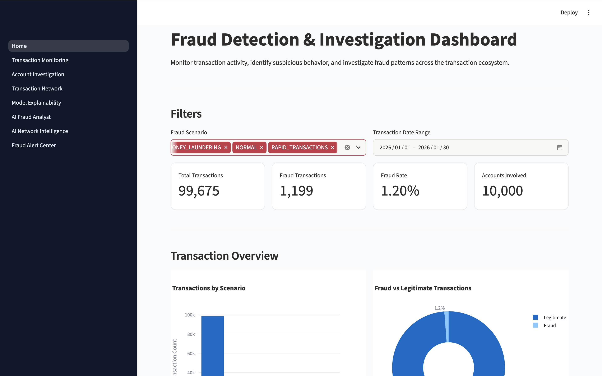
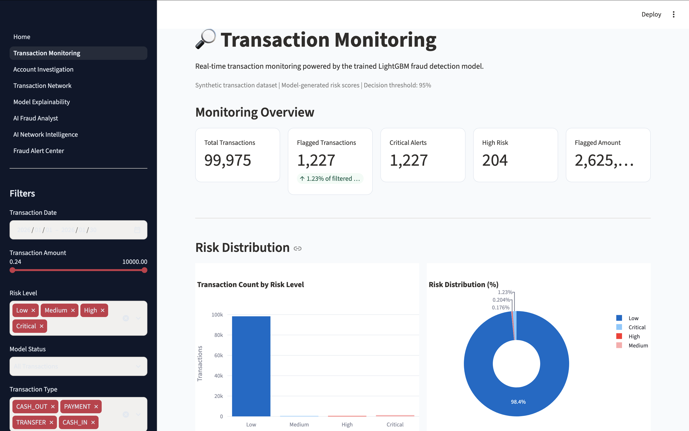
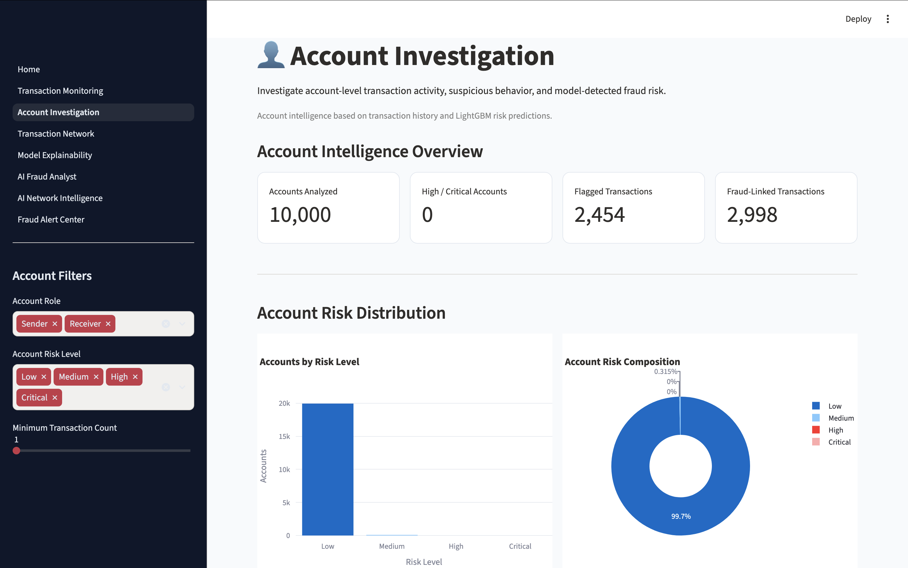
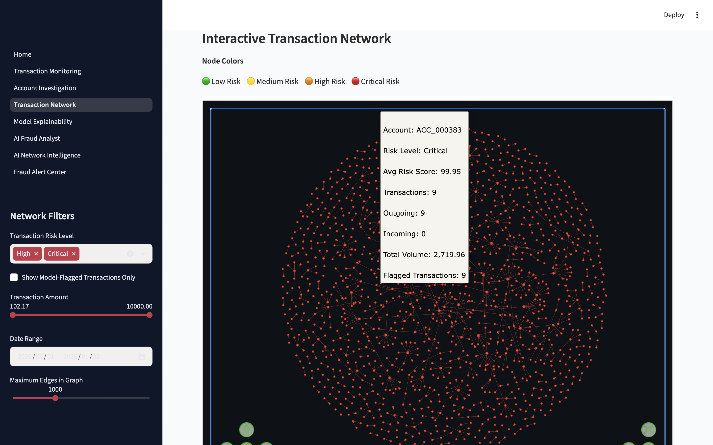
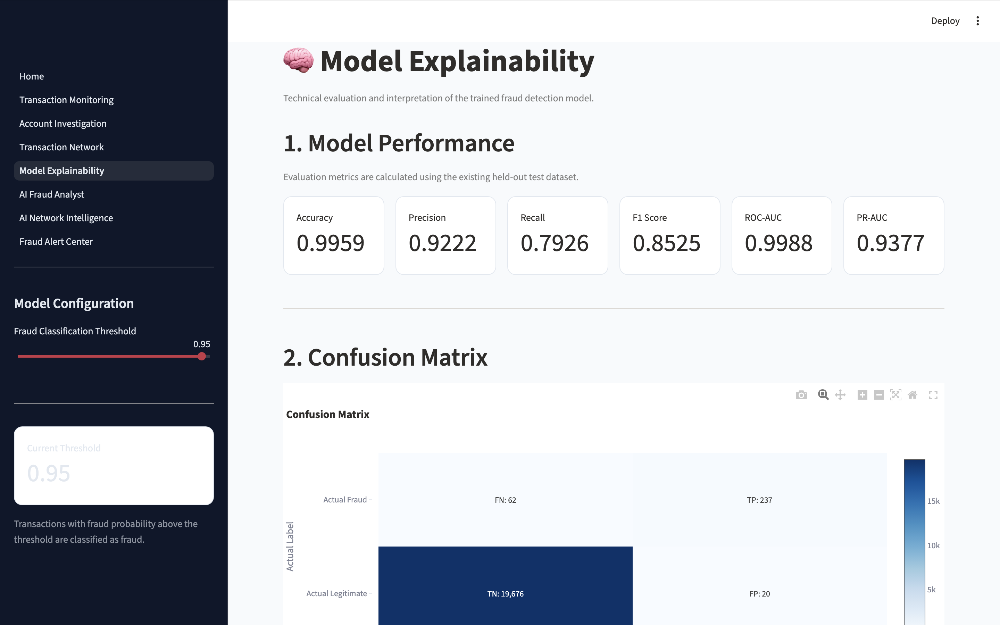
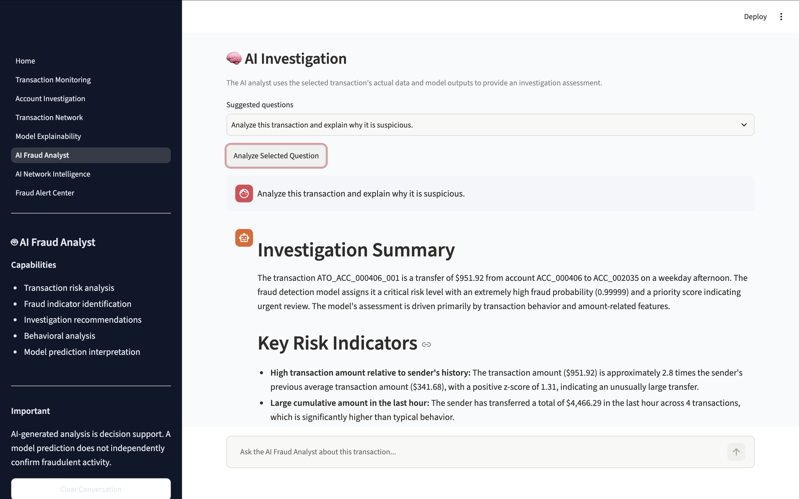
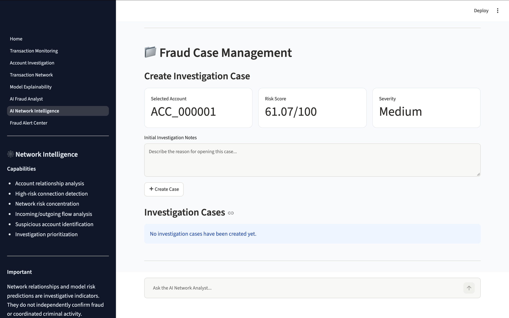
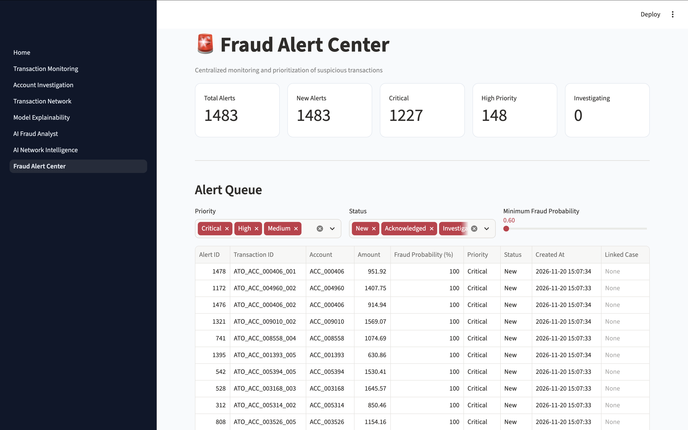
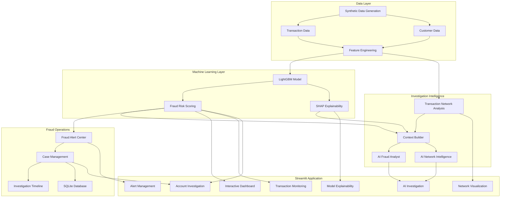

# 🛡️ Fraud Detection & Investigation Intelligence Platform

An end-to-end fraud detection and investigation platform combining machine learning, transaction analytics, graph-based investigation, explainable AI, and LLM-powered intelligence.

The platform enables analysts to monitor suspicious transactions, investigate customer accounts, explore transaction networks, understand fraud predictions, and manage alerts and investigation cases through an interactive dashboard.


---

## 📑 Table of Contents

- [Project Overview](#-project-overview)
- [Dashboard Preview](#-dashboard-preview)
- [Key Features](#-key-features)
- [System Architecture](#️-system-architecture)
- [Machine Learning Model](#-machine-learning-model)
- [Technology Stack](#-technology-stack)
- [Project Structure](#-project-structure)
- [Installation](#-installation)
- [Configuration](#-configuration)
- [Running the Application](#-running-the-application)
- [Dataset](#-dataset)
- [Future Improvements](#-future-improvements)
- [Disclaimer](#️-disclaimer)
- [Author](#-author)

---

## 🧭 Project Overview

Traditional fraud detection systems primarily focus on classifying transactions as fraudulent or legitimate. However, effective fraud investigation requires more than a prediction score.

This project extends machine learning-based fraud detection into an interactive investigation intelligence platform by combining predictive analytics, transaction network analysis, explainability, automated alerting, case management, and generative AI.

The platform provides a unified environment for exploring suspicious activity, investigating connected accounts, understanding model decisions, and supporting fraud investigation workflows.

### Objectives

- Detect suspicious transactions using machine learning.
- Assign fraud probability scores to transactions.
- Analyze transaction behavior and customer activity.
- Investigate relationships between accounts and transactions.
- Explain model predictions using SHAP.
- Generate AI-assisted investigation insights.
- Manage fraud alerts and investigation cases.

---

## 🖥️ Dashboard Preview


### Main Dashboard



### Transaction Monitoring



### Account Investigation



### Transaction Network



### Model Explainability



### AI Fraud Analyst



### AI Network Intelligence



### Fraud Alert Center



---

## ✨ Key Features

### 📊 Transaction Monitoring

- Interactive transaction explorer.
- Fraud probability and risk scoring.
- Filtering by transaction attributes, date, and fraud scenarios.
- Identification and prioritization of suspicious transactions.
- Transaction-level risk investigation.

### 👤 Account Investigation

- Customer and account-level investigation.
- Transaction history exploration.
- Behavioral analysis.
- Account risk assessment.
- Investigation context and supporting information.

### 🕸️ Transaction Network Analysis

- Graph-based visualization of transaction relationships.
- Connected account exploration.
- Transaction flow analysis.
- Investigation of suspicious network patterns.
- Identification of potentially related accounts and activities.

### 🔍 Model Explainability

- SHAP-based feature importance.
- Individual transaction prediction explanations.
- Analysis of factors contributing to fraud risk.
- Transparent model interpretation to support investigations.

### 🤖 AI Fraud Analyst

An LLM-powered investigation assistant that uses transaction and model context to support fraud analysis.

- Context-aware transaction investigation.
- AI-generated fraud analysis.
- Investigation summaries.
- Evidence-based insights.
- Interactive analyst queries.

### 🌐 AI Network Intelligence

AI-powered analysis of transaction network structures and connected entities.

- Network investigation assistance.
- Connected-account analysis.
- Identification and interpretation of suspicious relationships.
- Contextual network intelligence.

### 🚨 Fraud Alert Center

Centralized alert management for suspicious transactions.

- Automated alert generation based on fraud risk scores.
- Risk-based alert prioritization.
- Alert severity levels.
- Alert status management.
- Acknowledge, investigate, and resolve workflows.
- Alert-to-case conversion.

### 📁 Case Management

Investigation workflow management.

- Investigation case creation.
- Case status tracking.
- Investigation notes.
- Alert-linked cases.
- Investigation timeline.
- Audit trail.

---

## 🏗️ System Architecture

The platform is organized into data processing, machine learning, investigation intelligence, fraud operations, and application layers.



---

## 🤖 Machine Learning Model

The fraud classification model is built using **LightGBM**, a gradient boosting framework designed for efficient predictive modeling.

The model uses transaction-related behavioral, temporal, and statistical features to estimate the probability of fraudulent activity.

### Model Evaluation

| Metric | Score |
|---|---:|
| Precision | 0.8715 |
| Recall | 0.8395 |
| F1-Score | 0.8552 |
| ROC-AUC | 0.9987 |
| PR-AUC | 0.9376 |

### Evaluation Focus

- Imbalanced classification.
- Fraud detection performance.
- Precision-recall trade-off.
- Probability-based risk ranking.
- Feature importance and model explainability.

The evaluation prioritizes fraud detection performance while considering the trade-off between false positives and false negatives.

> **Note:** These metrics were obtained using a synthetic dataset and should not be interpreted as real-world financial fraud detection performance.

---

## 🛠️ Technology Stack

| Category | Technologies |
|---|---|
| Programming Language | Python |
| Machine Learning | LightGBM, Scikit-learn |
| Data Processing | Pandas, NumPy |
| Visualization | Plotly |
| Dashboard | Streamlit |
| Graph Analytics | NetworkX |
| Model Explainability | SHAP |
| Generative AI | LLM API, OpenRouter |
| Database | SQLite |
| Environment Management | Conda, python-dotenv |
| Development | Jupyter Notebook, VS Code |

---

## 📂 Project Structure

```text
synthetic_fraud_project/
│
├── dashboard/
│   ├── Home.py
│   ├── pages/
│   │   ├── 1_Transaction_Monitoring.py
│   │   ├── 2_Account_Investigation.py
│   │   ├── 3_Transaction_Network.py
│   │   ├── 4_Model_Explainability.py
│   │   ├── 5_AI_Fraud_Analyst.py
│   │   ├── 6_AI_Network_Intelligence.py
│   │   └── 7_Fraud_Alert_Center.py
│   │
│   ├── utils/
│   │   ├── model_utils.py
│   │   └── ui.py
│   │
│   └── components/
│
├── src/
│   ├── ai/
│   │   ├── context_builder.py
│   │   ├── fraud_analyst.py
│   │   ├── network_intelligence.py
│   │   └── __init__.py
│   │
│   ├── customer_generator.py
│   ├── transaction_generator.py
│   ├── fraud_scenarios.py
│   ├── alert_management.py
│   └── case_management.py
│
├── data/
│   ├── raw/
│   └── processed/
│
├── models/
│   └── lightgbm_model.pkl
│
├── notebooks/
│   ├── 01_data_generation.ipynb
│   ├── 02_data_exploration.ipynb
│   ├── 03_feature_engineering.ipynb
│   ├── 04_model_training.ipynb
│   └── 05_model_evaluation.ipynb
│
├── reports/
│
├── assests/
│   └── screenshots/
│
├── requirements.txt
├── .env.example
├── .gitignore
└── README.md
```

---

## ⚙️ Installation

### 1. Clone the repository

```bash
git clone https://github.com/YOUR_USERNAME/synthetic-fraud-project.git

cd synthetic-fraud-project
```

### 2. Create a virtual environment

```bash
python -m venv venv
```

### 3. Activate the environment

**macOS / Linux**

```bash
source venv/bin/activate
```

**Windows**

```bash
venv\Scripts\activate
```

### 4. Install dependencies

```bash
pip install -r requirements.txt
```

---

## 🔐 Configuration

AI-powered features require an API key.

Create a `.env` file in the project root:

```env
OPENAI_API_KEY=your_api_key_here
```

The application reads API credentials from environment variables using `python-dotenv`.

Never commit your `.env` file or API keys to GitHub.

---

## ▶️ Running the Application

Run the Streamlit application from the project root:

```bash
streamlit run dashboard/Home.py
```

The application will open in your browser.

---

## 📊 Dataset

This project uses synthetically generated transaction and customer data.

The data generation pipeline creates customer profiles, transaction records, and fraud scenarios to simulate financial activities for model development, testing, and investigation workflows.

The dataset supports:

- Fraud classification.
- Transaction behavior analysis.
- Customer-level investigation.
- Transaction network exploration.
- Fraud scenario analysis.
- Dashboard analytics.

The dataset is intended for educational, research, and demonstration purposes.

---

## 🔮 Future Improvements

- [ ] Real-time fraud scoring API.
- [ ] Model monitoring and data drift detection.
- [ ] Advanced graph-based fraud detection models.
- [ ] Automated investigation prioritization.
- [ ] Expanded model validation and ablation studies.
- [ ] Docker containerization.
- [ ] Cloud deployment.
- [ ] Automated testing pipeline.
- [ ] Authentication and role-based access control.

---

## ⚠️ Disclaimer

This project is developed for educational, research, and portfolio demonstration purposes using synthetic data.

It is not intended to be used as a production financial fraud detection system. Model predictions should not be used as the sole basis for real financial, compliance, or operational decisions.

---

## 👩‍💻 Author

**İrem İnç**

Computer Engineering | AI & Machine Learning | Data Analytics

Interested in building intelligent applications using machine learning, generative AI, data analytics, and software engineering.
